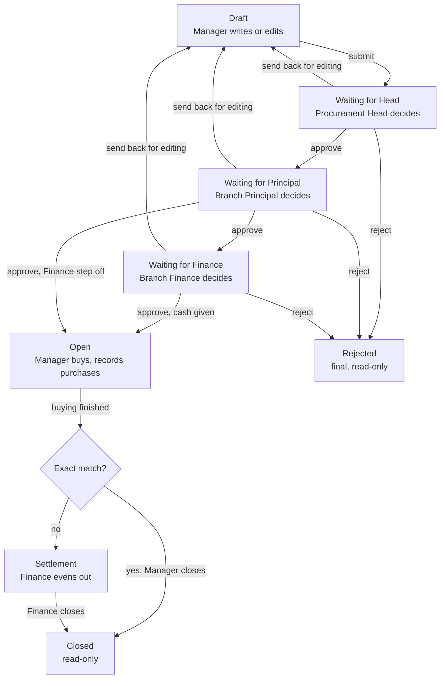

# Approval workflow

> Part of the School Procurement & Warehouse Platform spec, baseline of 10 October 2026 (document revision 123).
> Index and reading order: `docs/spec/00-index.md`. Read-only: this folder changes only through `/spec-change`.

Every order moves through ten statuses on its own; approval always runs Head, then Principal, then Finance (unless the Head has switched the Finance step off, see the end of this file), and each of them can decide on many ticked orders in one action.

Diagram: order flow, 8 states, 1 decision. Every arrow can carry many ticked orders in one action.

Read it top to bottom. Any of the three approvers can send an order back to the Manager or reject it. An order that was sent back shows the status Sent back for editing and is edited like a draft. Not drawn: the owner can cancel before approval finishes, the Head can reopen a closed order, and an order that skipped Finance closes without settlement (see "Finance step switched off" below).

## Statuses

| Code | Shown as | Meaning | Who acts next |
| --- | --- | --- | --- |
| `DRAFT` | Draft | Being written. Visible to the owner and the Head only. | Owner |
| `PENDING_HEAD` | Waiting for Head | Submitted. | Head |
| `PENDING_PRINCIPAL` | Waiting for Principal | Head approved. | Principal of the branch |
| `PENDING_FINANCE` | Waiting for Finance | Principal approved. | Finance of the branch |
| `RETURNED` | Sent back for editing | An approver asked for changes. | Owner |
| `PURCHASING` | Open | Fully approved. The Manager buys and records purchases. | Owner |
| `SETTLEMENT` | Waiting for settlement | Buying is finished and something differs from the plan. | Finance |
| `CLOSED` | Closed | Finished. Read-only. | Nobody |
| `REJECTED` | Rejected | Refused for good. Read-only. | Nobody |
| `CANCELLED` | Cancelled | Stopped by the owner or the Head before approval finished. | Nobody |

## Allowed moves

Each move applies to one order. An action on ticked orders makes the same move on each of them (rule 8).

| From | Action | Who | To | Needs |
| --- | --- | --- | --- | --- |
| Draft | Submit | Owner or Head | Waiting for Head (Waiting for Principal when the Head is the creator) | The order passes all checks |
| Waiting for Head | Approve | Head | Waiting for Principal |  |
| Waiting for Principal | Approve | Principal | Waiting for Finance (Open when the Finance step is off) |  |
| Waiting for Finance | Approve | Finance | Open | Optional cash in the same dialog (section 8) |
| Any "Waiting for" step | Send back | The approver of that step | Sent back for editing | Reason; optional note per order |
| Any "Waiting for" step | Reject | The approver of that step | Rejected | Reason |
| Waiting for Head | Take back | Owner | Draft | Only before the Head decides. The number is kept. |
| Sent back for editing | Submit again | Owner or Head | Waiting for Head | Revision number goes up by 1 |
| Any "Waiting for" step, Sent back, Draft with a number (taken back) | Cancel | Owner or Head | Cancelled | Reason |
| Open | Close (exact match) | Owner or Head | Closed | Section 8 rules |
| Open, skipped Finance | Close | Owner or Head | Closed | The order's buying is finished (section 7); see "Finance step switched off" |
| Open | Send to settlement | Owner or Head | Waiting for settlement | The order's buying is finished (section 7); the order did not skip Finance |
| Waiting for settlement | Send back for correction | Finance | Open | Reason |
| Waiting for settlement | Close | Finance | Closed | Section 8 rules |
| Closed | Reopen | Head | Open | Reason. Settlement confirmations and the overspend acknowledgment are cleared (section 8) |

Any move not in this table is impossible, in the screen and on the server.

## Rules

1. **Whole order.** Approvers cannot change any field, with one exception: Finance may change an order's payment type while approving. They approve, send back or reject the order as it is.
2. **Send back or reject.** "Send back" makes the order editable again for the owner. "Reject" is final; the owner can still use "Copy as new".
3. **Reasons.** Send back, reject, cancel and reopen need a reason of at least 5 characters. One reason covers all orders of one action; when sending back, the approver can add a note to each order.
4. **Start again after editing.** A corrected order goes back to the Head. Earlier approvals stay in the history but no longer count.
5. **What changed.** On a re-submitted order, approvers see the changed fields highlighted, with old and new values side by side.
6. **Frozen plan.** Once an order is Open, its plan can never be edited. Everything after that is recorded as purchases.
7. **Two people at once.** Each move checks the current status and version of every order inside the database transaction. The slower user sees "Already approved by Dilnoza at 14:32" and the list refreshes.
8. **Many orders, one action, all or nothing.** An action on ticked orders, or on a group row, checks every order first. If any of them is no longer in the expected status or version, or fails a check, nothing is saved: the screen names the orders that changed or failed and refreshes, and the user acts again. One action covers at most 200 orders.
9. **Reminders.** Orders waiting more than 24 hours trigger a reminder to the approvers of their step. After 48 hours the Head is told. Reminders are grouped (section 10). Both numbers are settings.
10. **Stock for approvers.** Each order shows stock at submit time and stock now, so an approver can see when an item has already arrived.
11. **History.** Every move is logged per order with the user, the time and the comment, and shown on the order's History tab. A move made in one action with other orders says so, for example "Approved by Head with 14 other orders".

## Finance step switched off

The Head can switch the Finance step off for the whole school, for example while the Finance team does not yet use the app, and on again later (owner's decision of 25 October 2026). It is the setting `finance_step`, on by default.

1. **Skipped.** While the step is off, the Principal's Approve moves an order straight to Open, and the order is marked as having skipped Finance. The mark is saved with the approval and never changes; a reopened order keeps it.
2. **No money.** An order that skipped Finance has no cash count: no money action has a row on it, it is left out of every Manager's cash balance and of Money with managers, and it never goes to settlement. Payment types are still planned and recorded on purchases.
3. **Closing.** The owner or the Head closes a finished order that skipped Finance whether or not it matches exactly, with the confirmation of an exact match (section 8). Nobody approves a difference; the three colours still show it. When the Head has switched off a Manager's right to close alone, the Head closes that Manager's orders.
4. **Big overspend.** The Head is notified as usual (section 8, Overspend guard), but no acknowledgment is needed to close.
5. **Switching off** is refused while any order is Waiting for Finance or Waiting for settlement; the Head sees those orders listed and switches off once none is left.
6. **Switching on** changes only orders the Principal approves from then on. An order that skipped Finance keeps these rules until it is Closed, and after a reopen.
7. Every switch is written to the audit log.
