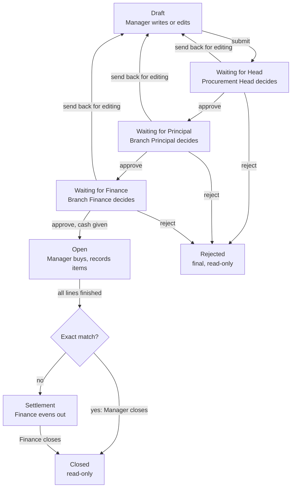

# Approval workflow

> Part of the School Procurement & Warehouse Platform spec, baseline of 10 October 2026 (document revision 123).
> Index and reading order: `docs/spec/00-index.md`. Read-only: this folder changes only through `/spec-change`.

A request moves through ten statuses; approval always runs Head, then Principal, then Finance, and each of them decides on the whole form.

Diagram: request flow, 8 states, 1 decision. Title in the original drawing: "Three approvals, then buying, then closing once the money is settled".

Read it top to bottom. Any of the three approvers can send the request back to the Manager or reject it. A request that was sent back shows the status Sent back for editing and is edited like a draft. Not drawn: the owner can cancel before approval finishes, and the Head can reopen a closed request.

## Statuses

| Code | Shown as | Meaning | Who acts next |
| --- | --- | --- | --- |
| `DRAFT` | Draft | Being written. Visible to the owner and the Head only. | Owner |
| `PENDING_HEAD` | Waiting for Head | Submitted. | Head |
| `PENDING_PRINCIPAL` | Waiting for Principal | Head approved. | Principal of the branch |
| `PENDING_FINANCE` | Waiting for Finance | Principal approved. | Finance of the branch |
| `RETURNED` | Sent back for editing | An approver asked for changes. | Owner |
| `PURCHASING` | Open | Fully approved. The Manager buys and records purchases. | Owner |
| `SETTLEMENT` | Waiting for settlement | Buying is finished and something differs from the plan. | Finance |
| `CLOSED` | Closed | Finished. Read-only. | Nobody |
| `REJECTED` | Rejected | Refused for good. Read-only. | Nobody |
| `CANCELLED` | Cancelled | Stopped by the owner or the Head before approval finished. | Nobody |

## Allowed moves

| From | Action | Who | To | Needs |
| --- | --- | --- | --- | --- |
| Draft | Submit | Owner or Head | Waiting for Head (Waiting for Principal when the Head is the creator) | Form passes all checks |
| Waiting for Head | Approve | Head | Waiting for Principal |  |
| Waiting for Principal | Approve | Principal | Waiting for Finance |  |
| Waiting for Finance | Approve | Finance | Open | Optional cash record in the same dialog (section 8) |
| Any "Waiting for" step | Send back | The approver of that step | Sent back for editing | Reason; optional notes on single lines |
| Any "Waiting for" step | Reject | The approver of that step | Rejected | Reason |
| Waiting for Head | Take back | Owner | Draft | Only before the Head decides. The number is kept. |
| Sent back for editing | Submit again | Owner | Waiting for Head | Revision number goes up by 1 |
| Any "Waiting for" step, Sent back | Cancel | Owner or Head | Cancelled | Reason |
| Open | Close (exact match) | Owner or Head | Closed | Section 8 rules |
| Open | Send to settlement | Owner or Head | Waiting for settlement | Every line finished |
| Waiting for settlement | Send back for correction | Finance | Open | Reason |
| Waiting for settlement | Close | Finance | Closed | Section 8 rules |
| Closed | Reopen | Head | Open | Reason |

Any move not in this table is impossible, in the screen and on the server.

## Rules

1. **Whole form.** Approvers cannot change any field, with one exception: Finance may change a line's payment type while approving. They approve, send back or reject the full request.
2. **Send back or reject.** "Send back" makes the request editable again for the owner. "Reject" is final; the owner can still use "Copy as new".
3. **Reasons.** Send back, reject, cancel and reopen need a reason of at least 5 characters. When sending back, the approver can tick the lines that need fixing and write a note on each.
4. **Start again after editing.** A corrected request goes back to the Head. Earlier approvals stay in the history but no longer count.
5. **What changed.** On a re-submitted request, approvers see added, removed and changed lines highlighted, with old and new values side by side.
6. **Frozen plan.** Once a request is Open, its planned lines can never be edited. Everything after that is recorded as purchases.
7. **Two people at once.** Each move checks the current status inside the database transaction. The slower user sees "Already approved by Dilnoza at 14:32" and the page refreshes.
8. **Reminders.** A request waiting more than 24 hours triggers a reminder to its approvers. After 48 hours the Head is told. Both numbers are settings.
9. **Stock for approvers.** Each line shows stock at submit time and stock now, so an approver can see when an item has already arrived.
10. **History.** Every move is logged with the user, the time and the comment, and shown on the request's History tab.
